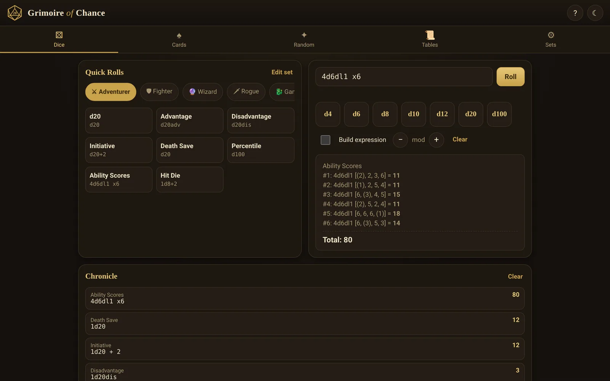
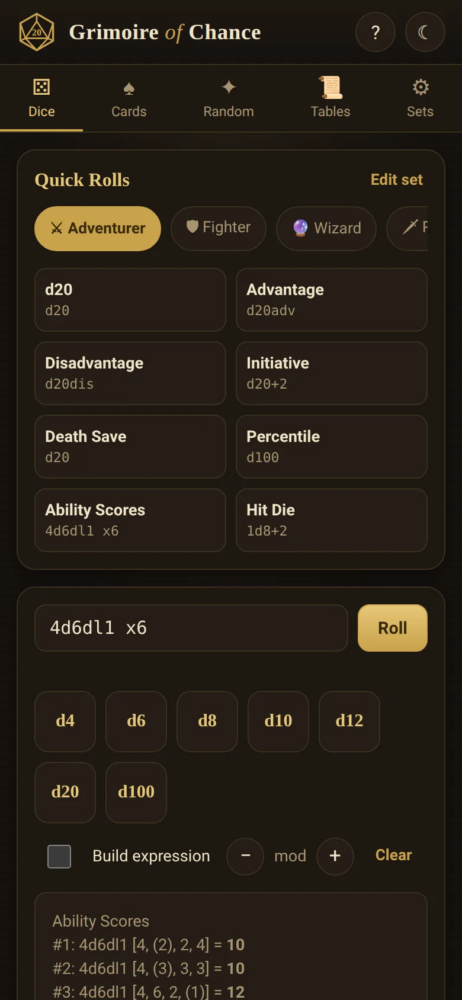

# Grimoire of Chance

[](https://github.com/ali-raheem/grimoire-of-chance/actions/workflows/test.yml) [](https://github.com/ali-raheem/grimoire-of-chance/actions/workflows/pages.yml)

**▶ Try it live: [shoryuken.me/dice](https://shoryuken.me/dice/)** · mirror on [GitHub Pages](https://ali-raheem.github.io/grimoire-of-chance/) · installable, works offline

<p align="center">
  <a href="https://shoryuken.me/dice/"></a>
  <a href="https://shoryuken.me/dice/"></a>
</p>

An installable, offline-first swiss-army-knife of randomness for tabletop RPGs:
dice expressions, playing/tarot/Deck-of-Many-Things cards, generic random tools,
and homebrew-able random tables — themed for D&D, with a quick-access bar of
per-character roll sets.

No build step, no dependencies, no server-side code. Plain HTML/CSS/JS modules
plus a service worker, so it installs as a PWA and works with the network off.

## Run it locally

```bash
python3 -m http.server 8080   # or any static file server
```

Then open `http://localhost:8080/` and, on a phone or desktop browser, use
the **Install** button (or the browser's "Add to Home Screen"/"Install app"
menu item) to add it as a standalone app. After the first load, it works
fully offline.

## Storage

Saved roll sets, tables and history live in `localStorage`; full offline
use comes from the service worker's Cache Storage. Both sit in the same
per-origin storage bucket, which browsers otherwise treat as "best-effort"
and can evict under disk pressure — silently breaking offline mode and
losing saved data at once, with no warning. On load, the app calls
`navigator.storage.persist()` (`js/store.js`) to ask for an exemption from
that automatic eviction. This is best-effort itself: unsupported in Safari,
and where it is supported the browser grants or denies it on its own
engagement heuristics (bookmarked, installed, actually used over time)
rather than a visible prompt, so it's most effective once the app has real
usage history behind it. Persistence is requested for the whole origin, not
just this app's path, so it benefits (and is satisfied by) any other app
sharing the same origin that has already requested it.

## Structure

| File | Purpose |
|---|---|
| `index.html` | App shell, all five views (Dice, Cards, Random, Tables, Sets) |
| `css/style.css` | Parchment/obsidian theme, light & dark |
| `js/dice.js` | Dice-expression parser/roller engine (`2d6+3`, `d20adv`, `4d6dl1`, exploding, rerolls, etc.) |
| `js/rng.js` | CSPRNG-backed random source + optional deterministic seeded mode |
| `js/cards.js` | Standard deck, Deck of Many Things, Tarot Major Arcana |
| `js/data.js` | Default roll sets, built-in random tables, name/NPC generators |
| `js/store.js` | `localStorage` persistence, import/export, persistent-storage request |
| `js/app.js` | UI wiring |
| `sw.js`, `manifest.webmanifest` | Offline caching + install metadata |
| `tests/*.test.mjs` | Unit tests (dice engine, persistence layer) |

## Dice notation

See the in-app help (`?` button) for the full cheat sheet: modifiers like
`kh`/`kl`/`dh`/`dl`, `adv`/`dis`, exploding (`!`, `!!`), rerolls (`r`, `ro`),
`min`/`max` clamps, parentheses, and `xN` repeats (e.g. `4d6dl1 x6` for a
full ability-score array).

## Tests

```bash
npm test
```

Runs on Node's built-in test runner (`node --test`) — no dependencies to
install. Covers the dice-expression engine, the RNG, and the persistence
layer (history capping, debounced/flushed saves, import/export). CI runs
this on every push against Node 20, 22 and 24 (see
`.github/workflows/test.yml`).

## Content credit

The Deck of Many Things card list is adapted from the *System Reference
Document 5.1* by Wizards of the Coast LLC, available under the Creative
Commons Attribution 4.0 International License. Effects shown in-app are
paraphrased summaries, not full rules text. This project is unofficial fan
content and is not affiliated with or endorsed by Wizards of the Coast.
